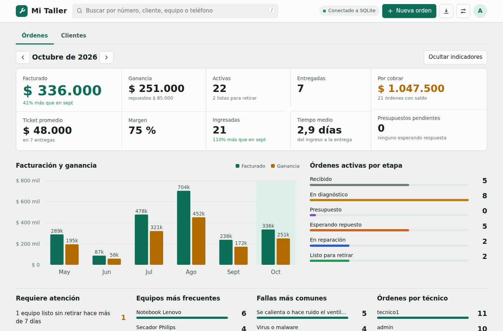
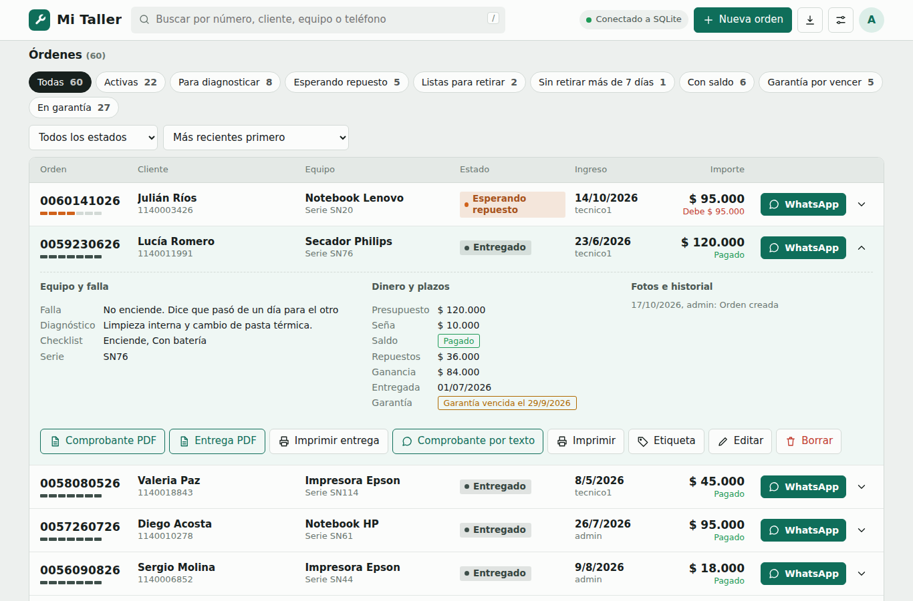
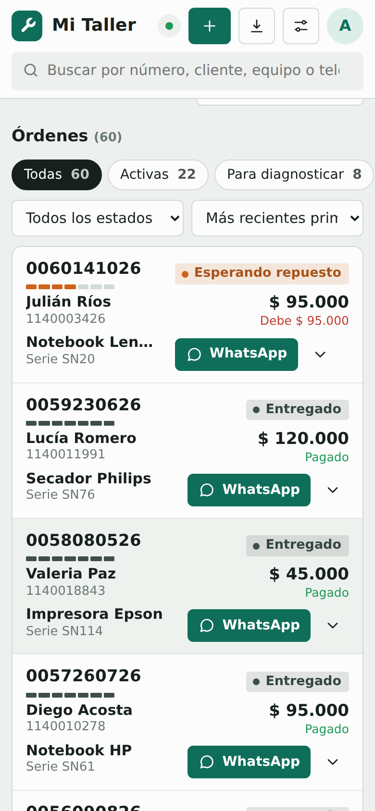
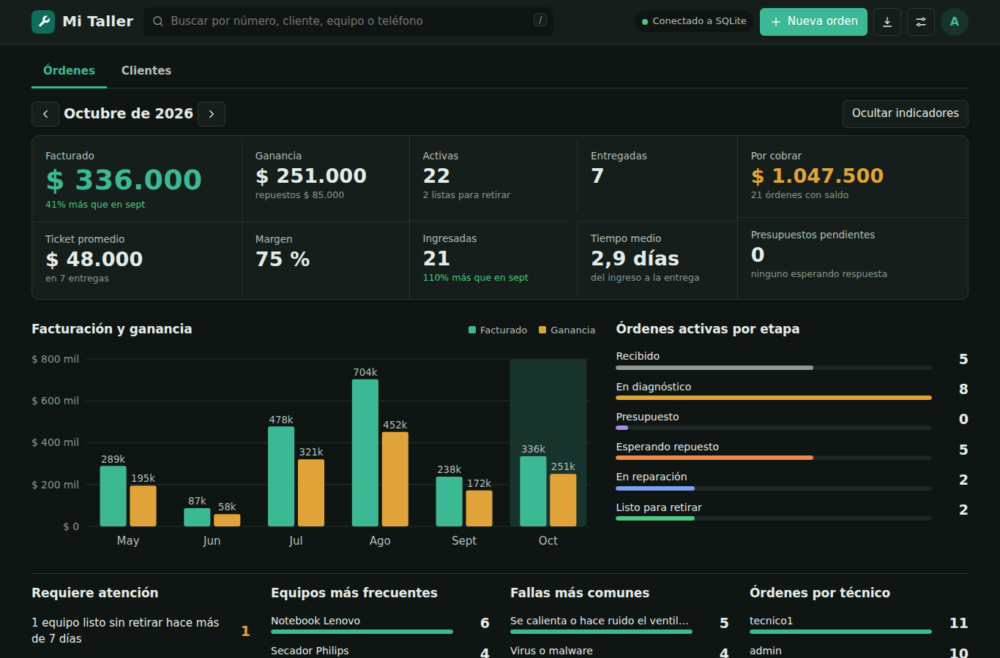
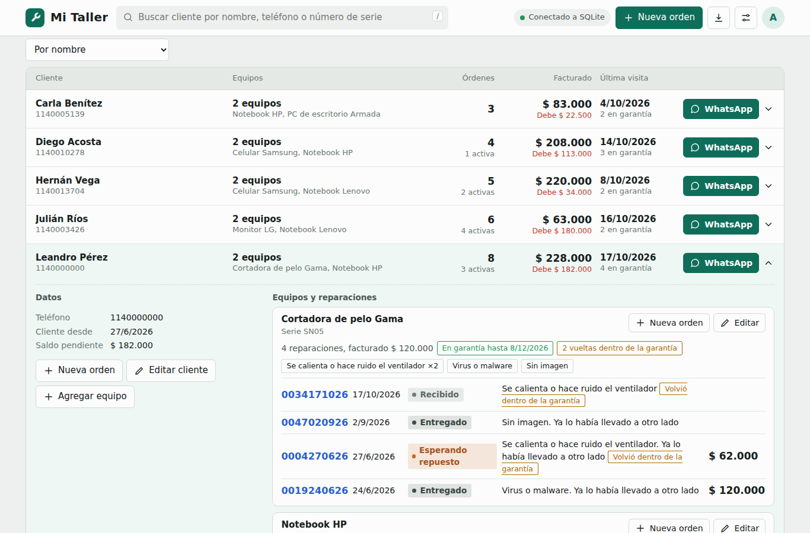

# CRM Técnico

Órdenes de servicio para un taller de reparaciones: ingreso con checklist, fotos y firma; presupuestos y avisos por
WhatsApp; comprobantes de ingreso y de entrega en PDF con QR; garantía; resumen del mes; usuarios con roles; app
instalable (PWA) y funcionamiento sin conexión con la base.





<p> &nbsp; </p>

## Clientes y equipos

Cada orden queda vinculada a un cliente y a un equipo, que se crean solos la primera vez (el mismo teléfono, escrito como sea, es el mismo cliente; el mismo número de serie, el mismo equipo).
En **Clientes** ves la ficha con los datos de contacto, todos sus equipos y la historia de reparaciones de cada uno, con las fallas que más se repiten y un aviso cuando un equipo
**vuelve dentro de la garantía**. Desde ahí podés cargar una orden nueva ya con el cliente y el equipo completos. Al corregir el teléfono o el nombre, se actualiza en todas sus órdenes.



Las **fallas** se eligen de un catálogo editable en ⚙️ (más un detalle libre), así el tablero cuenta "No enciende" una sola vez y no palabras sueltas.
El PDF que se le envía al cliente no lleva las fotos del equipo; quedan guardadas en la orden.

## Indicadores del tablero

Se calculan con las mismas columnas del CSV que se exporta a Excel (📥). Se muestran por mes y se navega con las flechas.

| Indicador | Cómo se calcula |
|---|---|
| Facturado | Suma del presupuesto de las órdenes **entregadas** en el mes |
| Ganancia y margen | Facturado menos el costo de repuestos de esas órdenes; margen = ganancia / facturado |
| Ticket promedio | Facturado / cantidad de órdenes entregadas |
| Activas | Órdenes que todavía no se entregaron |
| Entregadas / Ingresadas | Órdenes con fecha de entrega / de ingreso dentro del mes (con la comparación contra el mes anterior) |
| Tiempo medio | Promedio de días entre el ingreso y la entrega de lo entregado en el mes |
| Por cobrar | Saldo (presupuesto menos seña) de todas las órdenes con importe que no están pagadas |
| Presupuestos pendientes | Órdenes en estado Presupuesto y su importe total |
| Requiere atención | Listas sin retirar, presupuestos sin respuesta, entregas atrasadas, entregadas con saldo y garantías por vencer (los días de alerta se configuran en ⚙️) |

En cada fila del listado, la tira de siete segmentos muestra en qué etapa está la orden: recibido, en diagnóstico, presupuesto, esperando repuesto, en reparación, listo para retirar y entregado.

## Inicio rápido (Docker)

```bash
cp .env.example .env            # editá DATABASE_URL, POSTGRES_PASSWORD, DATA_PATH, PUID/PGID, ADMIN_PASSWORD
sudo mkdir -p /srv/crm/data
docker volume create crm_pgdata
docker compose up -d
docker compose exec crm python -m crm check-db      # debe decir "Motor: PostgreSQL"
```
Abrí `http://IP-DEL-SERVER:8000`. Más detalle (base en la nube, migrar tu `crm.db`, Cloudflare, actualizar): [docs/DESPLIEGUE.md](docs/DESPLIEGUE.md).

## Desarrollo

```bash
make run        # servidor local con SQLite en ./data (http://localhost:8000)
make test       # pruebas unitarias, de API y de la parte web (solo necesita Python)
make e2e        # prueba de navegador con Playwright
make help       # todos los comandos
python3 scripts/seed_demo.py http://localhost:8000 admin <clave>   # carga órdenes de ejemplo para ver el tablero con datos (solo desarrollo)
```
Sin Docker ni PostgreSQL alcanza con Python 3.10+. Para usar PostgreSQL: `pip install -r requirements.txt` y `DATABASE_URL=postgresql://...`.

## Estructura

```
crm-tecnico/
├── crm/                      el programa (paquete de Python)
│   ├── config.py             configuración leída del entorno (un solo objeto Settings)
│   ├── cli.py, __main__.py   comandos: serve, check-db, list-users, reset-password, migrate-sqlite
│   ├── app.py                arma las piezas (base, medios, servicio, límite de logins)
│   ├── api/                  capa HTTP: rutas, sesión, archivos estáticos (sin lógica de negocio)
│   ├── orders.py, clientes.py  casos de uso: órdenes, clientes y equipos
│   ├── service.py            datos con y sin conexión: cola de pendientes y sincronización
│   ├── db/                   modelos, migraciones numeradas y motores (SQLite / PostgreSQL)
│   ├── media.py, pdf.py, qr.py, security.py, bootstrap.py, migrate.py, log.py
│   └── web/                  lo que ve el navegador
│       ├── templates/        index.html, login.html
│       ├── static/css/       styles.css (sistema visual, modo oscuro, impresión)
│       ├── static/js/        db, util, dominio, comprobantes, dashboard, lista, clientes, orden, config, app
│       ├── static/img/
│       └── sw.js, manifest.webmanifest
├── tests/                    pruebas unitarias, de API y de navegador (e2e/)
├── docs/                     ARQUITECTURA.md, DESPLIEGUE.md
├── Dockerfile, docker-compose.yml, .env.example
├── Makefile, pyproject.toml, requirements*.txt
└── CHANGELOG.md
```

## Comandos útiles

| Qué | Comando |
|---|---|
| Verificar base y archivos | `docker compose exec crm python -m crm check-db` |
| Ver usuarios | `docker compose exec crm python -m crm list-users` |
| Restablecer una contraseña | `docker compose exec crm python -m crm reset-password admin 'NuevaClave123'` |
| Pasar un `crm.db` viejo a PostgreSQL | `docker compose run --rm -v /ruta/crm.db:/origen/crm.db:ro crm python -m crm migrate-sqlite /origen/crm.db` |
| Ver logs | `docker compose logs -f crm` |
